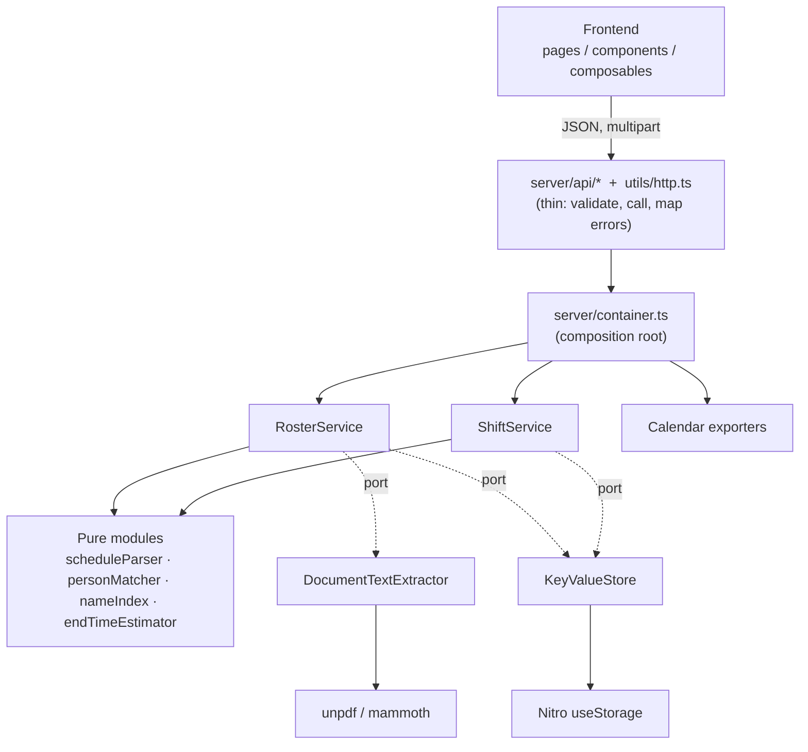

# 2. Architecture

## Layers and dependency rule



**The rule:** arrows only point down. Code under `server/modules/` and `server/domain/` is plain TypeScript. It must
not use Nitro auto-imports (`useRuntimeConfig`, `useStorage`, `defineEventHandler`, …) and always uses explicit
imports. That is why `npm test` runs without booting Nuxt, and why the same code could run in a CLI or worker.

Nitro globals are used in exactly these places: `server/api/**`, `server/utils/http.ts`, `server/container.ts`,
`server/infrastructure/nitroStore.ts`.

## Composition root

`server/container.ts` builds every service once (lazy singleton `getContainer()`), reading `useRuntimeConfig()`:

```ts
const roster = new RosterService({ extractor: new MultiFormatExtractor(), store: nitroStore('sessions'), ttlMs })
const shifts = new ShiftService({ roster, estimator: new EndTimeEstimator({...}), results: nitroStore('sessions'), sessionTtlMs: ttlMs })
```

It also exposes `google` (OAuth config + `enabled`) and `exportContext(person, locale)` (everything an exporter needs).
**To swap an implementation, change it here.** Nothing else knows which class is behind a port.

## Request lifecycles

### Upload (`POST /api/rosters`)

```mermaid
sequenceDiagram
  participant B as Browser
  participant A as api/rosters/index.post
  participant R as RosterService
  participant E as MultiFormatExtractor
  B->>A: multipart file
  A->>A: size check (maxUploadBytes)
  A->>R: ingest(bytes)
  R->>E: extract(bytes)  (sniff PDF/docx by magic bytes)
  E-->>R: plain text
  R->>R: parseSchedule -> blocks;  buildNameIndex;  findTypoSuspects
  R->>R: store roster:<uuid> (TTL)
  R-->>B: { id, names, typoSuspects }
```

### Typing suggestions (`GET /api/rosters/:id/names?q=`)
`RosterService.suggest` loads the stored index and calls `suggestNames`. No file is re-read. Debounced 120 ms in the UI.

### Preview (`POST /api/shifts/preview`)
`ShiftService.preview(rosterId, name, {typoCheck, include})`:
1. Load roster (`roster_expired` if missing/expired).
2. Keep only `include` spellings that really exist in the index.
3. `collect()`: walk blocks, keep people matching the name (normal matcher) or an included spelling, apply the
   merge rules, build drafts.
4. `EndTimeEstimator.estimate(draft)` per draft, then sort by date and start.
5. Compute `similar` (typo check on, or nothing found), store `result:<uuid>`, return the view.

### Export (`GET /api/exports/:id/ics`)
Loads the stored result and runs the exporter with `exportContext(person, locale)`. Languages are applied here,
not at preview time, so one result can be exported in German or English.

### Google (optional)
`/api/google/start` sets a nonce cookie and redirects to Google with `state = <resultId>.<nonce>.<lang>`.
`/api/google/callback` verifies the nonce, exchanges the code, inserts the events, and redirects to
`/?export=<id>&google=done&added=…&updated=…&failed=…`. The page reloads the result via `GET /api/exports/:id`.

## Data model and storage

Everything is kept in one Nitro storage mount, **`sessions`** (file driver, `./.data/sessions`):

| Key | Value | Written by | Lifetime |
|---|---|---|---|
| `roster:<uuid>` | `{ schedule, index, typoSuspects, expiresAt }` | `RosterService.ingest` | `sessionTtlHours` (default 168 h) |
| `result:<uuid>` | `{ person, shifts, similar, expiresAt }` | `ShiftService.preview` | same |

Expiry is checked lazily on read (`expiresAt < Date.now()` → delete and treat as missing). There is no sweeper;
expired entries that are never read stay on disk. If that matters, add a Nitro scheduled task (see
[07](07-extending.md#12-cleanup-job-for-expired-data)).

The uploaded file itself is **never** stored, only what was parsed from it.

## Time handling

* Dates are ISO strings `YYYY-MM-DD`; times are `HH:mm` strings. No `Date` objects in the domain.
* A shift whose `end <= start` ends **after midnight** (e.g. start `22:45`, end `00:15`). Exporters add one day.
* Time-zone work happens only at the edges, in `domain/time.ts`: `zonedToUtc` / `shiftInstants` (ICS uses UTC
  timestamps) and Google events use local time plus a `timeZone` field. The zone comes from `calendar.timezone`
  (default `Europe/Berlin`) and is DST-safe.

## Error handling

```
core code            throw new InputError('not_roster')          (server/domain/errors.ts)
API layer            rethrow(err) -> apiError(code)              (server/utils/http.ts)
HTTP                 createError({ statusCode, statusMessage: code, data: { code } })
frontend             e.data.data.code -> tError(code) -> t('err.<code>')   (locales)
```

* Add a code in three places: `ApiErrorCode` (types), the `STATUS` table (utils/http.ts), and `err.<code>` in both locales.
* Unexpected exceptions are logged (`[api]`) and returned as `read_failed` (HTTP 500), never as a stack trace.

## Internationalisation

* `locales/de.ts` is the **source of truth for keys**. `locales/en.ts` is typed `Record<keyof typeof de, string>`,
  so a missing key is a compile error. `tests/locales.spec.ts` also checks key parity and empty strings.
* The same dictionaries serve the UI (`useLocale().t`) and the server (`translate(locale, key, params)`) for
  calendar titles and descriptions.
* Venue names are proper nouns and are **not** translated. Roster notes are shown as written (German).
* The chosen language lives in the cookie `shiftsync-locale`; exports take `?lang=de|en`.

## Security notes

* File type is detected from bytes (`sniffFormat`), never from the file name or MIME type.
* Upload size is limited (`maxUploadBytes`, default 5 MiB). `include` is capped at 10 strings and filtered to
  names that exist in the roster; query strings are length-limited.
* Result and roster ids are random UUIDs (unguessable); possession of the id grants access. There is **no
  authentication**. Put the app behind your own access control if the roster is sensitive.
* Google: state nonce in an `httpOnly`, `sameSite=lax` cookie (10 min), the access token is used once in memory
  and never stored.
