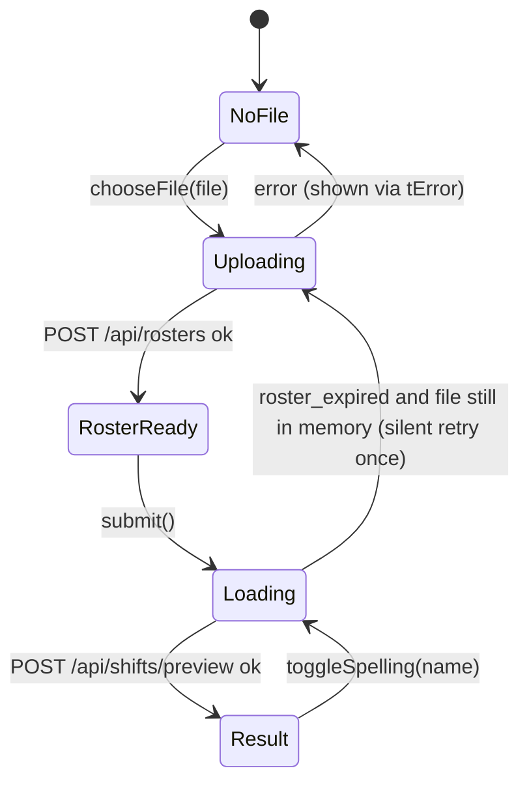

# 6. Frontend

The frontend is intentionally thin: it holds UI state, calls the API, and renders. It contains no matching,
estimating or formatting rules beyond display.

## Files

| File | Responsibility |
|---|---|
| `app.vue` | `<NuxtPage />` only |
| `pages/index.vue` | the single page: upload, name field, typo check, results, actions |
| `components/NameCombobox.vue` | accessible autocomplete (WAI-ARIA combobox) |
| `components/LanguageSwitch.vue` | DE / EN toggle |
| `composables/useShifts.ts` | all request/response state and API calls |
| `composables/useLocale.ts` | language state + `t`, `tn`, `tError` |
| `assets/main.css` | all styling (design tokens + component styles) |

## State flow



Returning from Google: the URL is `/?export=<id>&google=done…`; `onMounted` calls `loadExport(id)`, which restores the
result without a roster (so the similar-spelling checkboxes are disabled in that state).

## `useShifts()` API

| Member | Type | Notes |
|---|---|---|
| `name` | `Ref<string>` | cookie `shiftsync-name` (1 year) |
| `typoCheck` | `Ref<boolean>` | cookie `shiftsync-typocheck`, default `true` |
| `file`, `roster`, `result` | refs | the picked `File`, `RosterInfo`, `PreviewResponse` |
| `uploading`, `loading` | `Ref<boolean>` | |
| `errorCode` | `Ref<string \| null>` | an API error code; translate with `tError` |
| `include` | `Ref<string[]>` | confirmed misspelled entries |
| `chooseFile(f)` | | resets state, uploads immediately |
| `submit()` | | clears `include`, requests a preview |
| `toggleSpelling(name)` | | add/remove from `include`, re-requests the preview |
| `suggest(q)` | `Promise<NameStat[]>` | never throws (suggestions must not block typing) |
| `loadExport(id)` | | restore after the Google redirect |

Errors are read as `e.data.data.code` (Nitro wraps `createError({ data })` one level deeper).

## `useLocale()` API

```ts
const { locale, t, tn, tError } = useLocale()
t('app.title')                                   // plain
t('form.rosterReady', { count: 45 })             // {count} interpolation
tn('result.title', n, { person })                // picks result.title.one / .other and injects {count}
tError('roster_expired')                         // -> err.roster_expired, or err.generic if unknown
```
`locale` is a cookie (`shiftsync-locale`); the composable also sets `<html lang>`. Dates are formatted with
`Intl.DateTimeFormat(locale.value, …)` in the page.

## Components

### `NameCombobox`
Props: `modelValue`, `fetchSuggestions(q)`, `label`, `placeholder`, `listLabel`. Emits `update:modelValue`.
Behaviour: debounced (120 ms) fetch; stale responses are dropped with a sequence counter; ↑/↓ move, Enter picks
(and does **not** submit the form while an option is highlighted), Esc closes; options are chosen on `mousedown`
so the input does not blur first. ARIA: `role=combobox`, `aria-expanded`, `aria-controls`, `aria-activedescendant`,
list `role=listbox`, items `role=option`.

### `LanguageSwitch`
Renders one button per entry of `LOCALES` (`aria-pressed`). Adding a language needs no change here.

## Page structure (`pages/index.vue`)

1. Language switch, headline.
2. Form card: drop zone (accepts `.pdf`, `.docx`) → status line ("45 names found") → `NameCombobox` →
   typo-check checkbox → submit button → error line.
3. "Possible typos in the roster" `<details>` (only when the checkbox is on and a roster is loaded).
4. Google banner (from the query string).
5. Result: title, period, then either the empty state ("Did you mean …" chips) or the
   *similar spellings* fieldset, the shift list, legend, and the action buttons.

Action buttons:
* **Apple Calendar** → `ics?inline=1&lang=…`
* **Google Calendar** → `links.googleAdd` if present, else a button that downloads the file and opens Google's import page
* **Download** → `ics?lang=…` with the `download` attribute

## Styling

Plain CSS in `assets/main.css`, no framework. Colours and fonts are CSS variables on `:root`, with a dark theme
via `prefers-color-scheme`:

```
--paper --card --ink --muted --line --accent --accent-ink --warn --warn-bg --serif --sans
```

Change the palette there only. The signature element is the "call sheet" row (`.shift`): a large tabular call time,
a dotted perforation (`.call` border), then the details. Respect `prefers-reduced-motion` (already handled).

## Accessibility checklist for new UI

* Every input has a visible `<label>`; icons/colour never carry meaning alone (estimates use `~`, not just grey).
* Focus styles are defined (`:focus-visible` outline); keep them.
* Dynamic results live in `aria-live="polite"`, errors use `role="alert"`, status uses `role="status"`.
* Test with keyboard only.

## SSR note

Nuxt renders on the server. Browser-only APIs (`document`, `window`) must stay inside event handlers or `onMounted`
(see `googleFallback`). Cookies are read through `useCookie`, which works on both sides.
